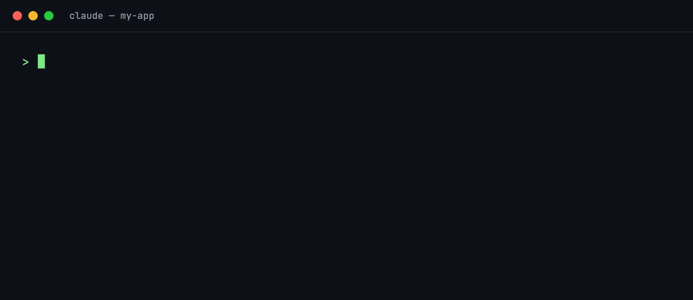
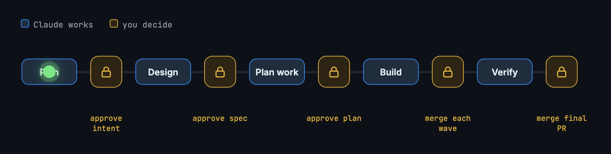
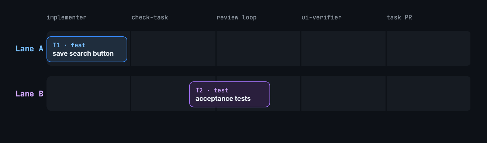
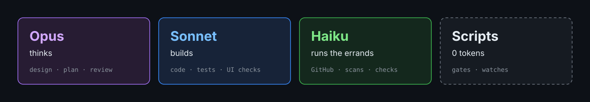
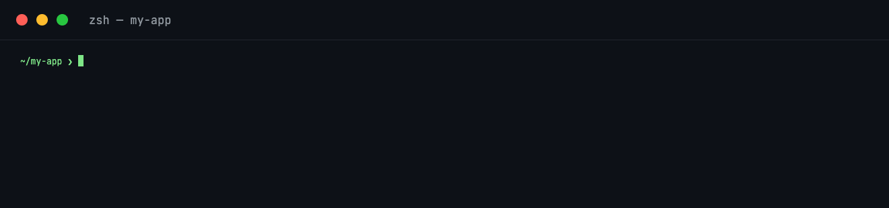

<h1 align="center">
  <picture>
    <source media="(prefers-color-scheme: dark)" srcset="docs/assets/logo-dark.svg">
    
  </picture>
</h1>

<p align="center">A Claude Code plugin that takes a feature from a rough idea to merged pull requests, with a human approving every gate.</p>

<p align="center">
  
  <a href="LICENSE"></a>
</p>

<p align="center">
  
</p>

## Contents

- [How it works](#how-it-works)
- [Review only the final PR](#review-only-the-final-pr)
- [Saving tokens](#saving-tokens)
- [Commits and branches](#commits-and-branches)
- [Turn hard rules into lint rules or tests](#turn-hard-rules-into-lint-rules-or-tests)
- [Requirements](#requirements)
- [Install](#install)
- [Check](#check)
- [Status](#status)
- [Notifications](#notifications)
- [More](#more)
- [Developing](#developing)
- [Releasing](#releasing)
- [License](#license)

## How it works

<p align="center">
  
</p>

1. **Plan** – `/workez:plan-feature <idea>` writes `intent.md` and opens a feature issue.
2. **Design** – `spec.md`, checked by a spec reviewer.
3. **Plan the work** – `plan.md`: waves of at most two tasks, size limits, acceptance-criteria coverage, then one GitHub sub-issue per task.
4. **Build** – two lanes in parallel: implementer → size/format guard → review loop → Playwright UI check → task PR. A watch starts the next wave after you merge, fixes PR feedback and failed CI checks, and tells you about merge conflicts.
5. **Verify** – checks, E2E, an AC table and a whole-feature review on a throwaway merge with the base branch; PASS or FAIL with a fix plan.

The `Stop` hook moves from one phase to the next. Nothing in the workflow approves or force-pushes, and by default it merges nothing: you merge every task PR and the final PR. To review only the final PR, see [Review only the final PR](#review-only-the-final-pr).

**One small change?** `/workez:build-task <change>` (or `#<issue>`) skips the phases: you approve a one-task plan, and it runs the same pipeline (implementer, review loop, UI check, full test suite) to one PR straight to the base branch, then watches it until you merge.

<p align="center">
  
</p>

## Review only the final PR

One optional key in `.claude/workflow.json` takes the task PRs off your plate:

```json
"auto_merge": { "task_prs": true, "method": "merge" }
```

- **`auto_merge.task_prs`** (off by default): the build merges a task PR into the feature's integration branch with a merge commit once it is ready: local review PASS, UI check passed, every CI check green, no unhandled feedback and no conflict. Anything else waits for you as before. The merge goes through `scripts/merge-task-pr.sh`, which refuses a protected branch, the base branch, a changed head or a failing check. It works with GitHub and with the local tracker (`git merge --no-ff`, then a push of the integration branch when there is a remote). The build waits for each task PR with a script (`gh-watch.sh --until-settled`, in the background: no tokens, no 10-minute cron) and merges it as soon as it is ready. **The final PR and `build-task` PRs are never merged for you.**
- **`## Notable issues`**: with or without auto-merge, the final PR (and a `build-task` PR) ends with at most 8 one-line bullets from the build's `notes.md`, such as review blockers and how they were fixed, wontfix items, flaky or failed checks, conflicts left to you, blocked tasks and verify findings. Read this first. It says `None.` when nothing stood out.

With it on, you act at the gates (intent, spec, plan), on anything reported as blocked or in conflict, and on the final PR. Details: "Auto-merge of task PRs" in [WORKFLOW.md](WORKFLOW.md).

## Saving tokens

<p align="center">
  
</p>

Every token goes where it counts.

- **Right model, right job**: Opus thinks, Sonnet builds, Haiku runs the errands.
- **Scripts first**: gates and watches cost zero tokens.
- **Lean context**: each agent reads only what its task needs.

### Token usage report

When a feature closes (or a `build-task` PR is merged), the workflow adds up the tokens its sessions and subagents used, per phase, agent and model, with an estimated cost at API list prices (a Claude subscription is billed differently). It is read from Claude Code's own transcripts by `scripts/token-usage.sh`, with no model and no extra GitHub call: the report goes to the file and the script prints only its `**Total:**` line (no model reads the report); it is part of the closing comment on the feature or task issue, and a copy stays in `.claude/token-usage/<feature>.md`, which is git-ignored and never committed or pushed. `status.sh` shows the running total. Prices are built in; add or override them with `pricing` in `.claude/workflow.json` (see `WORKFLOW.md`).

## Commits and branches

Commits follow [Conventional Commits 1.0.0](https://www.conventionalcommits.org/en/v1.0.0/), and branches use the same types:

| | Format | Example |
|---|---|---|
| Commit | `<type>[(scope)][!]: <description>`, blank line, body, footers | `feat(search): add the save search button` … `Refs: #44` |
| Feature (integration) branch | `feat/<feature issue>-<slug>` | `feat/39-saved-searches` |
| Task branch | `<type>/<task issue>-<slug>` | `fix/52-empty-query` |
| Task PR title | `<type>[(scope)]: <description> (#<issue>)` | `test: add saved search acceptance tests (#41)` |

Types: `feat`, `fix`, `docs`, `style`, `refactor`, `perf`, `test`, `build`, `ci`, `chore`, `revert`. A breaking change adds `!` and a `BREAKING CHANGE:` footer. Each task in the plan has a **Type** and an optional **Scope**; verify's fix tasks are `fix`.

They are checked three times: the `check-conventions.sh` hook blocks a `git commit -m` or a new branch (`checkout -b`, `switch -c`, `branch`, `worktree add -b`) that breaks them, `check-task.sh` checks the task's branch and every commit subject before review and PR, and `/workez:doctor` checks the `naming` patterns. The types, the subject length (72) and the patterns live in `conventions` and `naming` of `.claude/workflow.json`; remove `conventions` (and set `branches.prefix`) to turn the checks off.

## Turn hard rules into lint rules or tests

The planner and the reviewer can only check placement against rules that are written down. `workez:project-context` looks for a **Structure** standard (folders, layers, who may import whom, where shared helpers live) in `CLAUDE.md`, `AGENTS.md` at any depth (a nested one is scoped to its folder) and `ARCHITECTURE*`. The plan lists what it found under `## Standards` and gives each task a `Placement:` line; the reviewer runs a structure checklist on every task. When nothing is found you see this warning, and the work goes on:

```
No structure rules found for <area>; placement cannot be checked
```

Even then the reviewer catches a misplaced file late, after it is written. The strongest form of a rule is a check that fails CI. Write the rule once in prose, then enforce it.

Example `## Structure` section in `CLAUDE.md` or `AGENTS.md` for a Hono API:

```markdown
## Structure
- `src/routes/`: parse input, call a service, return the response. No business logic, no DB access.
- `src/services/`: business logic. Shared lookups (`findUserById`) live in `src/services/users.ts`.
- `src/db/`: the DB client (`src/db/client.ts`) and schema. Only `src/db/` and services import the client.
```

Enforce it with an ESLint override (flat config) that bans the DB client in routes:

```js
{
  files: ["src/routes/**/*.ts"],
  rules: {
    "no-restricted-imports": ["error", {
      patterns: [{ group: ["**/db", "**/db/*", "@app/db", "drizzle-orm"],
        message: "Routes call services; only services and src/db import the DB client." }],
    }],
  },
}
```

Without ESLint, a few lines of bash in CI do the same (`tests/fixtures/structure-rules/check-route-imports.sh` is tested here):

```bash
bad="$(grep -rlE "from ['\"][^'\"]*db/client['\"]" src/routes || true)"
[[ -z "$bad" ]] || { echo "routes must not import the db client: $bad"; exit 1; }
```

## Requirements

Check these before you install; `/workez:doctor` checks them for you afterwards.

**On the machine**

| Tool | Version | Used for |
|---|---|---|
| Claude Code | recent, interactive session | plugins, subagents, and `CronCreate` for the build watch (without auto-merge) and the verify watch (they run only while the session is open, for up to 7 days) |
| `git` | 2.42+ | worktrees per task (`worktree add --orphan` for the evidence branch) |
| `gh` | signed in (`gh auth login`); not needed with the local tracker | issues, sub-issues, labels, PRs |
| `jq` | 1.6+ | every script reads `workflow.json` with it |
| `bash` | 3.2+ | scripts and hooks (the macOS default works) |
| `curl`, `lsof` | any | dev server readiness and ports |
| Node.js + `npx` | 18+ | the two Playwright MCP servers (`@playwright/mcp`) |
| Google Chrome | any | the UI checks run headless Chrome (`npx playwright install chrome` if missing) |

**On GitHub** (not needed with the local tracker, see below)

- The repository's issues are enabled, and your account can write to it (push branches, create labels, issues and PRs).
- Sub-issues are available (github.com has them).
- Optional: a PR reviewer on task PRs, such as `templates/github-workflows/claude-review.yml` with the `CLAUDE_CODE_OAUTH_TOKEN` secret. Optional: "Automatically delete head branches", since the workflow never deletes remote branches.

**In the project**

- A git repository with a remote that points at that GitHub repository, and the base branch pushed to it (with the local tracker: any remote, or none).
- A base branch for features: `branches.base`, `dev` by default and set to any name during setup.
- `CLAUDE.md` describing the stack, the rules and how to run one test: every phase reads it.
- Commands for install, build, lint, format check and test, a way to run given test files with a JSON report (acceptance), and, for UI checks, a dev server that can start on two separate sets of ports.
- No copy of the plugin's hooks or scripts in the project's own `.claude/` (the hooks would run twice).

**No GitHub? The local tracker**

Projects on GitLab, another host, or with no remote at all set `"tracker": "local"` in `workflow.json` (`/workez:setup` suggests it when `gh` or a GitHub remote is missing). Every phase runs the same, with no `gh`: features and their phase are tracked in `.claude/workflow/`, branches and titles carry no issue numbers (`feat/<feature>`, `<type>/<feature>-<task>`), and each task "PR" is a merge request file with a ready-made title, description and, on GitLab, a "new merge request" link. You open and merge the merge requests on your host; the build reads the merges from git and starts the next wave. After a squash merge, say "T3 is merged" (or run `scripts/mark-merged.sh <feature> T3`). Without a remote, the file holds the `git merge` command for you to run. What you give up: PR review feedback and failed CI checks are not read automatically, and screenshots stay local. Details: "Local tracker" in `WORKFLOW.md`.

## Install

```
/plugin marketplace add trihuynh-agilityio/workez        # or the path of a local clone
/plugin install workez@workez
```

The plugin adds two Playwright MCP servers to every session where it is enabled; to keep them out of other projects, enable it per project with `claude plugin install workez@workez --scope project`.

Then, in each project:

```
/workez:setup
```

It writes `.claude/workflow.json` (repository, branches, commands, formatters, dev servers and ports), merges the permission rules into `.claude/settings.json` and adds the runtime folders to `.gitignore`. In a project without `.claude/workflow.json` the plugin's hooks do nothing.

## Check

```
/workez:doctor
```

Runs `scripts/doctor.sh`, which changes nothing and prints one line per check: the tools and versions above, the `workflow.json` keys and their consistency (a warning when the removed `lane_runner` key is still set; branch names under `branches.prefix`, lanes `A` and `B`, distinct ports, existing command folders), the permission rules and `.gitignore` lines from setup, `CLAUDE.md`, a duplicate copy of the plugin in the project, the git remote and base branch, and on GitHub the sign-in, issues, write access and sub-issues. `FAIL` means the workflow will break; `WARN` means it runs with something missing. Run it after setup and whenever you change `workflow.json`.

## Status

<p align="center">
  
</p>

```bash
bash <plugin>/scripts/status.sh [--short] [feature]
```

Run it from a shell inside the project: no Claude session, no tokens. It reads every `.claude/workflow/*/state.json` and the `pr-states.tsv` next to it, and prints per feature (and `build-task`) its phase and status, who acts next (`you` or `Claude`) and what to do, the task statuses, the PR states as last recorded, and the session watch. It never calls GitHub, so PR states are as fresh as the last build or verify run. Features waiting on you come first, and the last line names them. `--short` prints one line per feature: feature, phase / status, who and next.

## Notifications

<p align="center">
  
</p>

On macOS, `hooks/notify-on-finish.sh` shows a notification whenever Claude needs you, so you can leave the session running in the background. The title is the project folder and why (`needs your answer`, `needs your approval` or `finished`), the subtitle the current branch, and the message the question, the permission request or the start of Claude's last reply. A phase hand-off from the `Stop` hook never notifies, so you hear from it only when Claude really stops. Only sessions that ran a workez skill notify (other sessions in the same project stay quiet), and each at most once every 15 seconds (set `WF_NOTIFY_COOLDOWN` to change it). To turn them off for yourself in one project, create `.claude/workflow.local.json` (gitignored by `setup-project.sh`):

```json
{ "notify": false }
```

`"notify": false` in `workflow.json` turns them off for everyone, and `workflow.local.json` overrides it either way. To turn them off in every project, set `WF_NOTIFY` to `off` in the `env` of `~/.claude/settings.json`; it wins over both files. Off macOS it does nothing.

## More

- [WORKFLOW.md](WORKFLOW.md): phases, parts, how scripts find the project, and the `workflow.json` reference.
- [templates/workflow.example.json](templates/workflow.example.json): a complete config for a Vite + FastAPI project.
- Tests: `bash tests/run-all.sh` (throwaway repositories, fake `gh`, never touches GitHub).
- Check a project from a shell: `bash <plugin>/scripts/doctor.sh [--offline]` from inside it.

## Developing

This repository is both the plugin and its marketplace (`.claude-plugin/plugin.json` and `.claude-plugin/marketplace.json`, with the plugin's `source` set to `./`).

- Try local changes: `claude --plugin-dir .` from the repository root, or `/reload-plugins` in a running session.
- Check the manifests: `claude plugin validate .`
- Note every change under `## [Unreleased]` in [CHANGELOG.md](CHANGELOG.md) as you make it.

## Releasing

Versions follow semantic versioning (what counts as major, minor or patch is at the top of the changelog). Installed copies update only when `version` in `.claude-plugin/plugin.json` changes, so every release bumps it:

Work lands on `dev` through PRs; a release goes from `dev` to `main`:

1. On a `chore/release-X.Y.Z` branch cut from `origin/dev`:
   ```bash
   tools/release.sh minor --dry-run   # or patch, major, X.Y.Z: shows the notes that will be released
   tools/release.sh minor             # moves Unreleased under the new version, sets plugin.json
   git commit -am "chore(release): vX.Y.Z"
   ```
   Open a PR `chore(release): vX.Y.Z` into `dev` and merge it.
2. Open a PR `release: sync dev into main (vX.Y.Z)` from `dev` into `main` and merge it.
3. Tag the merge commit on `main` and push the tag:
   ```bash
   git tag -a vX.Y.Z -m "vX.Y.Z" origin/main && git push origin vX.Y.Z
   ```
4. Publish the GitHub Release from that tag, with the version's changelog section as its notes (a pushed tag alone does not show on the Releases page):
   ```bash
   tools/release.sh notes X.Y.Z | gh release create vX.Y.Z --verify-tag --title vX.Y.Z --latest --notes-file -
   ```

Users then get it with `/plugin marketplace update workez`. CI runs `tools/check-version.sh`, which fails when `plugin.json` has a version without its own changelog section.

## License

[MIT](LICENSE) © Tri Viet Huynh
