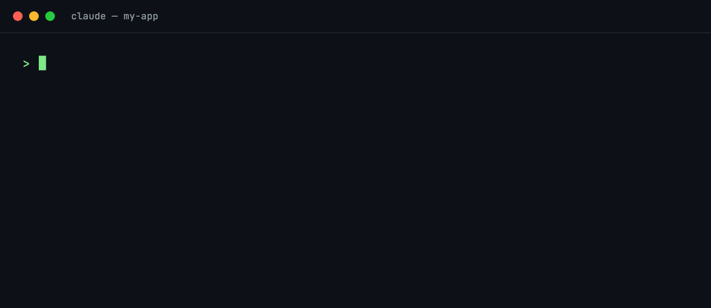
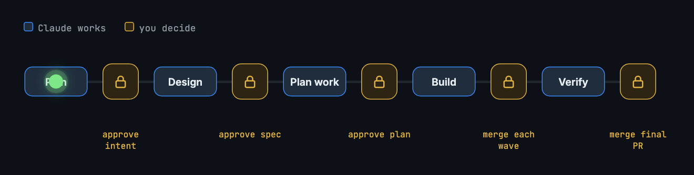
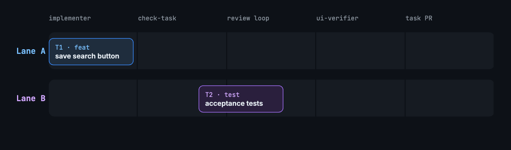
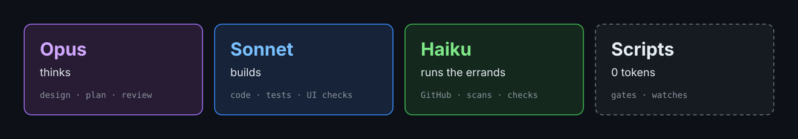
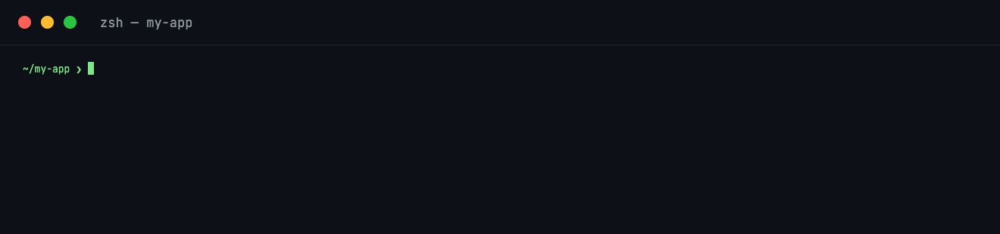

<h1 align="center">
  <picture>
    <source media="(prefers-color-scheme: dark)" srcset="docs/assets/logo-dark.svg">
    
  </picture>
</h1>

<p align="center">A Claude Code plugin that takes a feature from a rough idea to merged pull requests, with a human approving every gate.</p>

<p align="center">
  
  <a href="LICENSE"></a>
</p>

<p align="center">
  
</p>

## Contents

- [How it works](#how-it-works)
- [Saving tokens](#saving-tokens)
- [Commits and branches](#commits-and-branches)
- [Requirements](#requirements)
- [Install](#install)
- [Check](#check)
- [Status](#status)
- [Notifications](#notifications)
- [More](#more)
- [Developing](#developing)
- [Releasing](#releasing)
- [License](#license)

## How it works

<p align="center">
  
</p>

1. **Plan** – `/workez:plan-feature <idea>` writes `intent.md` and opens a feature issue.
2. **Design** – `spec.md`, checked by a spec reviewer.
3. **Plan the work** – `plan.md`: waves of at most two tasks, size limits, acceptance-criteria coverage, then one GitHub sub-issue per task.
4. **Build** – two lanes in parallel: implementer → size/format guard → review loop → Playwright UI check → task PR. A session watch starts the next wave after you merge, and fixes PR feedback.
5. **Verify** – checks, E2E, an AC table and a whole-feature review on a throwaway merge with the base branch; PASS or FAIL with a fix plan.

The `Stop` hook moves from one phase to the next. Nothing in the workflow merges, approves or force-pushes.

**One small change?** `/workez:build-task <change>` (or `#<issue>`) skips the phases: you approve a one-task plan, and it runs the same pipeline (implementer, review loop, UI check, full test suite) to one PR straight to the base branch, then watches it until you merge.

<p align="center">
  
</p>

## Saving tokens

<p align="center">
  
</p>

Every token goes where it counts.

- **Right model, right job**: Opus thinks, Sonnet builds, Haiku runs the errands.
- **Scripts first**: gates and watches cost zero tokens.
- **Lean context**: each agent reads only what its task needs.

## Commits and branches

Commits follow [Conventional Commits 1.0.0](https://www.conventionalcommits.org/en/v1.0.0/), and branches use the same types:

| | Format | Example |
|---|---|---|
| Commit | `<type>[(scope)][!]: <description>`, blank line, body, footers | `feat(search): add the save search button` … `Refs: #44` |
| Feature (integration) branch | `feat/<feature issue>-<slug>` | `feat/39-saved-searches` |
| Task branch | `<type>/<task issue>-<slug>` | `fix/52-empty-query` |
| Task PR title | `<type>[(scope)]: <description> (#<issue>)` | `test: add saved search acceptance tests (#41)` |

Types: `feat`, `fix`, `docs`, `style`, `refactor`, `perf`, `test`, `build`, `ci`, `chore`, `revert`. A breaking change adds `!` and a `BREAKING CHANGE:` footer. Each task in the plan has a **Type** and an optional **Scope**; verify's fix tasks are `fix`.

They are checked three times: the `check-conventions.sh` hook blocks a `git commit -m` or a new branch (`checkout -b`, `switch -c`, `branch`, `worktree add -b`) that breaks them, `check-task.sh` checks the task's branch and every commit subject before review and PR, and `/workez:doctor` checks the `naming` patterns. The types, the subject length (72) and the patterns live in `conventions` and `naming` of `.claude/workflow.json`; remove `conventions` (and set `branches.prefix`) to turn the checks off.

## Requirements

Check these before you install; `/workez:doctor` checks them for you afterwards.

**On the machine**

| Tool | Version | Used for |
|---|---|---|
| Claude Code | recent, interactive session | plugins, subagents, and `CronCreate` for the build and verify watches (they run only while the session is open, for up to 7 days) |
| `git` | 2.42+ | worktrees per task (`worktree add --orphan` for the evidence branch) |
| `gh` | signed in (`gh auth login`) | issues, sub-issues, labels, PRs |
| `jq` | 1.6+ | every script reads `workflow.json` with it |
| `bash` | 3.2+ | scripts and hooks (the macOS default works) |
| `curl`, `lsof` | any | dev server readiness and ports |
| Node.js + `npx` | 18+ | the two Playwright MCP servers (`@playwright/mcp`) |
| Google Chrome | any | the UI checks run headless Chrome (`npx playwright install chrome` if missing) |

**On GitHub**

- The repository's issues are enabled, and your account can write to it (push branches, create labels, issues and PRs).
- Sub-issues are available (github.com has them).
- Optional: a PR reviewer on task PRs, such as `templates/github-workflows/claude-review.yml` with the `CLAUDE_CODE_OAUTH_TOKEN` secret. Optional: "Automatically delete head branches", since the workflow never deletes remote branches.

**In the project**

- A git repository with a remote that points at that GitHub repository, and the base branch pushed to it.
- `CLAUDE.md` describing the stack, the rules and how to run one test: every phase reads it.
- Commands for install, build, lint, format check and test, a way to run given test files with a JSON report (acceptance), and, for UI checks, a dev server that can start on two separate sets of ports.
- No copy of the plugin's hooks or scripts in the project's own `.claude/` (the hooks would run twice).

## Install

```
/plugin marketplace add trihuynh-agilityio/workez        # or the path of a local clone
/plugin install workez@workez
```

The plugin adds two Playwright MCP servers to every session where it is enabled; to keep them out of other projects, enable it per project with `claude plugin install workez@workez --scope project`.

Then, in each project:

```
/workez:setup
```

It writes `.claude/workflow.json` (repository, branches, commands, formatters, dev servers and ports), merges the permission rules into `.claude/settings.json` and adds the runtime folders to `.gitignore`. In a project without `.claude/workflow.json` the plugin's hooks do nothing.

## Check

```
/workez:doctor
```

Runs `scripts/doctor.sh`, which changes nothing and prints one line per check: the tools and versions above, the `workflow.json` keys and their consistency (branch names under `branches.prefix`, lanes `A` and `B`, distinct ports, existing command folders), the permission rules and `.gitignore` lines from setup, `CLAUDE.md`, a duplicate copy of the plugin in the project, the git remote and base branch, and on GitHub the sign-in, issues, write access and sub-issues. `FAIL` means the workflow will break; `WARN` means it runs with something missing. Run it after setup and whenever you change `workflow.json`.

## Status

<p align="center">
  
</p>

```bash
bash <plugin>/scripts/status.sh [--short] [feature]
```

Run it from a shell inside the project: no Claude session, no tokens. It reads every `.claude/workflow/*/state.json` and the `pr-states.tsv` next to it, and prints per feature (and `build-task`) its phase and status, who acts next (`you` or `Claude`) and what to do, the task statuses, the PR states as last recorded, and the session watch. It never calls GitHub, so PR states are as fresh as the last build or verify run. Features waiting on you come first, and the last line names them. `--short` prints one line per feature: feature, phase / status, who and next.

## Notifications

<p align="center">
  
</p>

On macOS, `hooks/notify-on-finish.sh` shows a notification whenever Claude needs you, so you can leave the session running in the background. The title is the project folder and why (`needs your answer`, `needs your approval` or `finished`), the subtitle the current branch, and the message the question, the permission request or the start of Claude's last reply. A phase hand-off from the `Stop` hook never notifies, so you hear from it only when Claude really stops. Off macOS it does nothing.

## More

- [WORKFLOW.md](WORKFLOW.md): phases, parts, how scripts find the project, and the `workflow.json` reference.
- [templates/workflow.example.json](templates/workflow.example.json): a complete config for a Vite + FastAPI project.
- Tests: `bash tests/run-all.sh` (throwaway repositories, fake `gh`, never touches GitHub).
- Check a project from a shell: `bash <plugin>/scripts/doctor.sh [--offline]` from inside it.

## Developing

This repository is both the plugin and its marketplace (`.claude-plugin/plugin.json` and `.claude-plugin/marketplace.json`, with the plugin's `source` set to `./`).

- Try local changes: `claude --plugin-dir .` from the repository root, or `/reload-plugins` in a running session.
- Check the manifests: `claude plugin validate .`
- Note every change under `## [Unreleased]` in [CHANGELOG.md](CHANGELOG.md) as you make it.

## Releasing

Versions follow semantic versioning (what counts as major, minor or patch is at the top of the changelog). Installed copies update only when `version` in `.claude-plugin/plugin.json` changes, so every release bumps it:

```bash
tools/release.sh patch --dry-run   # or minor, major, X.Y.Z: shows the notes that will be released
tools/release.sh patch             # moves Unreleased under the new version, sets plugin.json
git commit -am "Release v0.1.1" && git tag -a v0.1.1 -m "v0.1.1" && git push --follow-tags
```

Users then get it with `/plugin marketplace update workez`. CI runs `tools/check-version.sh`, which fails when `plugin.json` has a version without its own changelog section.

## License

[MIT](LICENSE) © Tri Viet Huynh
